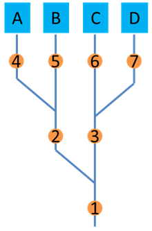

uam4x Basics
================

High Level Goal
----------------

The goal of the uam4x framework is to provide a robust and flexible platform for various
kinds of urban air mobility (UAM) analyses.

The framework allows for easy centralized and traceable management of the study at hand.
The study contains three high level components:

1. Vehicles: Contains the vehicles used in a study, which themselves
   contain components and modes (e.g vertical and horizontal rotor configurations)
2. Solution: Defines the steps that when followed sequentially make up the analysis
3. Control: Defines the overarching goals of the analysis (e.g parameter sweep, optimization, etc.)

uam4x supports the creation of the study, the running of the various analyses,
and the post processing of the results all of which can be done via the uam4x API.

The uam4x Workflow
-------------------

The most basic intended workflow of the uam4x framework is a four file approach with the following files:

1. The custom plugins and components file (if needed)
2. The branching script
3. The analysis script
4. The post processing script

The Custom Plugins and Components File
~~~~~~~~~~~~~~~~~~~~~~~~~~~~~~~~~~~~~~~

The goal of the custom plugins and components file is to
clearly define any custom components associated with the particular study as
well as any custom plugins that will be used as steps in the solution (more on both
components and plugins below). These plugins and components can then be imported
and used in the branching script.

The Branching Script
~~~~~~~~~~~~~~~~~~~~

The goal of the branching script is to define one or more studies using functions mentioned
in the discussion on variants at the bottom of the page. The various functions are then combined and run to
create one or more studies (variants). The functions that go into constructing a study
take in a study object and then set various parameters via the study API.

The branching script should be run and the various variants saved resulting in a model.json for
each study which contains the full definition of that particular study.

The Analysis Script
~~~~~~~~~~~~~~~~~~~

The goal of the analysis script is merely to run one or more of the defined analyses within one or more studies
and to save the raw results. The results are automatically saved to a results.json containing all
requested raw results.

The Post Processing Script
~~~~~~~~~~~~~~~~~~~~~~~~~~

The goal of the post processing script is to interface with the raw results and extract meaningful
results (max/min, plots, etc.) which can be done easily via the Study's results and post processing APIs.

How Vehicles Work
------------------
A Vehicle in uam4x is a collection of components each of which have their own parameters and optionally
modes. uam4x contains predefined components such as wings and rotors that can be added to a particular
Vehicle. The user is also able to define their own custom components which can be added to a particular
vehicle. The study can own one or more Vehicles.

How Components Work
-------------------
A component is an object described by various parameters. For example, a wing is a component which
can be described by its span, chord, twist, etc. Components are added to a Vehicle to define
that Vehicle. Components may have various modes (a rotor may have a veritical and horizontal configuration).

How the Solution Works
----------------------
The Solution defines steps and groups (collections of steps) which are run sequentially.
The smallest unit of work within the Solution is a step. A step contains inputs, outputs and
some defined computation all of which is defined via a Plugin. Multiple steps may be connected with links
which connect outputs of one plugin to inputs of another. Steps may also take in Vehicle parameters
as inputs. The Solution manages these steps and defines links as well as requested outputs which will be
saved to the Results.

How Plugins Work
-----------------
Plugins which are used to define steps in a solution have a standardized format where the inputs
and outputs are defined via a plugin setup and the particular plugin is run via a plugin run method. uam4x
provides some select plugins to interface with but the user is also able to define their own plugins following
the general plugin format.

How the Control Works
----------------------
The Control defines one or more analyses to be run for a particular study such as
parameter sweeps, optimizations, and nested optimizations within a parameter sweep.

How Results Work
-----------------
Given one or more analyses run, the Results class stores the requested outputs. The Results
class provides an API to the user to view and interact with the raw results.

How Post Processing Works
-------------------------
uam4x contains a few prebuilt post processing classes that allow for an easy interface
to get typical results (e.g plot two variables against one another). The user can also define
their own methods to interface and process the raw results.

A Note on Variants
-------------------

A key concept that the uam4x framework supports is Variants. Variants
are essentially variations of a particular study. A study can be thought of
as an object containing vehicles, a solution sequence, a control and associated results or
it can be thought of as a collection of functions that go on to build that study.
The variant interpretation is the second interpretation where the study can be thought
of as a collection of functions that go on to build that study. Generally,
the intended way to create a study is via a set of functions that set up various
aspects of the study e.g:

* Function 1: Creates and adds vehicles to the study
* Function 2: Creates and adds the solution to the study
* Function 3: Creates and adds the various analyses to the study

It is entirely reasonable then to have two or more studies that are similar in kind
e.g a particular underlying vehicle configuration with different solution steps (e.g mission profiles).
Instead of creating the vehicle configuration twice, the user can construct each of the studies
with the same underlying vehicle configuration functions but replace or amplify the solution creation functions.
Then these two distinct studies are said to be variants of one another (as they share underlying creation functions
but are not identical).

   Diagram of the branching script that results in four variants labeled A, B, C, and D.
   The numbers circled in orange indicate different functions or code segments