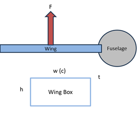

User Guide
==========

This guide provides step-by-step instructions for using uam4x.

Getting Started: Multi-Objective Optimization Example
-----------------------------------------------------

The goal is to do a parameter sweep and optimization of a simple wing
with varying weighting factors between drag and weight as the objective.

    Diagram of the simple wing box model used in the multi-objective example.

The ``multi_objective`` example is a complete end-to-end pattern for:

1. Declaring custom subsystems and plugins
2. Building a model and trade studies
3. Generating a model JSON
4. Running the analysis and reading results

First, check out the example repository:

.. code-block:: bash

   git clone git@github.com:M4-Development/uam4x_multiobjective.git
   cd uam4x_multiobjective

You can also use HTTPS:

.. code-block:: bash

   git clone https://github.com/M4-Development/uam4x_multiobjective.git
   cd uam4x_multiobjective

Required Plugin: OpenVSP
""""""""""""""""""""""""

The ``multi_objective`` example uses ``OpenvspPlugin``:

.. code-block:: python

   from uam4x_openvsp.plugin import OpenvspPlugin

Before running the example, install both:

1. OpenVSP itself (includes the Python API used by ``import openvsp``)
2. The uam4x OpenVSP plugin package (``uam4x_openvsp``)

OpenVSP install:

.. code-block:: text

   Download and install OpenVSP from https://openvsp.org/

Install the plugin package from the plugins repo:

.. code-block:: bash

   git clone https://github.com/M4-Development/uam4x_plugins.git
   cd uam4x_plugins/openvsp
   pip install -e .

Verify the OpenVSP Python module is available in your active environment:

.. code-block:: bash

   python -c "import openvsp; print('openvsp import OK')"

Step 1: ``custom.py`` (custom subsystem + plugins)
""""""""""""""""""""""""""""""""""""""""""""""""""

This file defines the reusable building blocks used by the solution graph.

The subsystem is registered with ``@register_subsystem`` so it can be added to a vehicle:

.. code-block:: python

   @register_subsystem
   class WeightingFactor(Subsystem):
       def setup(self):
           self.add_parameter(
               "weighting_factor",
               0.0,
               float,
               unit_type=UnitType.LENGTH,
               description="Wing span",
           )

The first plugin computes area and exposes exact derivatives:

.. note::

   Plugin inputs must declare a concrete Python type in ``setup_plugin`` (for example ``float`` or ``int``).
   Use ``self.declare_input("name", input_type, default_value)`` for every input so uam4x can validate links and
   correctly construct optimization variables/derivatives.

.. code-block:: python

   @register_plugin
   class CalcArea(Plugin):
       def setup_plugin(self, plugin_options):
           self.declare_input("aspect_ratio", float, 1.0)
           self.declare_input("span", float, 1.0)
           self.declare_output("area", float, 1.0)
           self.declare_partials_plugin(["area"], ["span", "aspect_ratio"], method="exact")

       def run_plugin(self, links, work_dir):
           area = (links["span"] ** 2) / links["aspect_ratio"]
           return {"area": area}

       def compute_partials_plugin(self, links):
           return {
               ("area", "span"): 2 * links["span"] / links["aspect_ratio"],
               ("area", "aspect_ratio"): -links["span"] ** 2 / links["aspect_ratio"] ** 2,
           }

The second plugin computes chord, drag, wing weight, and objective:

.. code-block:: python

   @register_plugin
   class CalcObjective(Plugin):
       def setup_plugin(self, plugin_options):
           self.declare_input("aspect_ratio", float, 1.0)
           self.declare_input("span", float, 1.0)
           self.declare_input("area", float, 1.0)
           self.declare_input("weighting_factor", float, 1.0)
           self.declare_output("chord", float, 1.0)
           self.declare_output("CD", float, 1.0)
           self.declare_output("wing_weight", float, 1.0)
           self.declare_output("objective", float, 1.0)
           self.declare_partials_plugin("*", "*", method="exact")

       def run_plugin(self, links, work_dir):
           if links["weighting_factor"] < 0:
               raise PluginException("plugin failed")
           # ... compute CD, wing_weight, objective
           return {
               "chord": chord,
               "CD": self.CD,
               "wing_weight": W_box,
               "objective": objective,
           }

       def compute_partials_plugin(self, links):
           # ... return analytical derivative dictionary
           return partial_to_val

Step 2: ``branching_script.py`` (model setup + variant generation)
""""""""""""""""""""""""""""""""""""""""""""""""""""""""""""""""""

This file wires the study in three setup functions.

Model setup:

.. code-block:: python

   def setup_model(study: Study):
       veh1 = Vehicle("multi_objective_vehicle")
       wing1 = Wing("wing1")
       wing1.set_parameter("span", 100.0)
       factor = WeightingFactor("weighting_factor")
       veh1.add_component(wing1)
       veh1.add_component(factor)
       study.add_vehicle(veh1)

Solution setup:

.. code-block:: python

   from uam4x.solution import Solution

   def setup_solution(study: Study):
       solution = Solution("basic")
       solution.add_step(CalcArea, "calc_area")
       solution.add_link(
           "vehicles.multi_objective_vehicle.wing1.aspect_ratio",
           "calc_area.aspect_ratio",
       )
       solution.add_link(
           "vehicles.multi_objective_vehicle.wing1.span",
           "calc_area.span",
       )
       solution.add_step(CalcObjective, "calc_objective")
       solution.add_link("calc_area.area", "calc_objective.area")
       solution.add_tracked_output("calc_objective.objective")
       study.add_solution(solution)

Trade-study setup:

.. code-block:: python

   def setup_tradestudy(study: Study):
       optimization = Optimization()
       optimization.add_design_var(
           "vehicles.multi_objective_vehicle.wing1.aspect_ratio",
           lower=1.0,
           upper=10.0,
       )
       optimization.add_design_var(
           "vehicles.multi_objective_vehicle.wing1.span",
           lower=100.0,
           upper=1000.0,
       )
       optimization.add_constraint("calc_area.area", lower=49999.0, upper=50001.0)
       optimization.add_objective("calc_objective.objective")

       parameter_sweep = ParameterSweep(
           {"vehicles.multi_objective_vehicle.weighting_factor.weighting_factor": [-10, 0, 5000, 10000]},
           optimization,
       )
       study.control.add_tradestudy("sweep", parameter_sweep)
       study.control.add_tradestudy("optimization_only", optimization)

Variant generation in ``__main__``:

.. code-block:: python

    if __name__ == "__main__":
        # define variants
        demo = [setup_model, setup_solution, setup_tradestudy]
        # setup framework
        framework = Variants(THIS_DIR)
        framework.add_variant('demo', demo)
        study = framework.generate_variants()[0]
        save_path = os.path.join(THIS_DIR, "variants","demo")
        study_from_json = Study.from_json(save_path)

Step 3: ``run_analysis.py`` (execute trade studies)
"""""""""""""""""""""""""""""""""""""""""""""""""""""""""

This script loads the generated variant and runs both trade studies.

.. code-block:: python

   if __name__ == "__main__":
    study_dir=os.path.join(THIS_DIR, "variants", "demo")
    study = Study.from_json(study_dir)
    engine = Engine(study, os.path.join(study_dir,"work"))
    engine.run_tradestudy("sweep", solution_name="basic",num_processors=10)
    engine.run_solution("basic")
    engine.run_tradestudy("optimization_only", solution_name="basic")
    study.save_results_to_json(study_dir)

Generate an N² diagram
^^^^^^^^^^^^^^^^^^^^^^^

An execution engine can generate a standalone interactive N² diagram without
executing the solution:

.. code-block:: python

    engine = Engine(study, os.path.join(study_dir, "work"))

    # Show the base uam4x solution structure.
    engine.generate_N2("basic")

    # Highlight one analysis's design variables, constraints, and objective.
    engine.generate_N2(
        "basic",
        trade_name="optimization_only",
        outfile=os.path.join(study_dir, "optimization_n2.html"),
        show_browser=False,
    )

    # Open directly inside one large group or plugin.
    engine.generate_N2(
        "basic",
        path="aerodynamics.rotor_analysis",
        max_visible_rows=100,
    )

The native viewer displays the solution/group hierarchy, declared plugin inputs
and outputs, unconnected inputs, indexed links, feed-forward and feedback
connections, cycles, tracked outputs, and optimization roles. Its OpenMDAO-style
controls support hierarchy zoom and history, system collapse and aggregation,
connection tracing and pinning, search, solver/execution-order columns,
and optimization highlighting. The matrix renders ``solution`` as its
outermost system column and adds
one lateral column for every nested uam4x group level before the leaf plugin and
variable columns. Clicking any group or plugin band focuses that system and adds
the view to navigation history. ``Fit`` scales the complete diagram—hierarchy,
variables, matrix, and solver bands—against both the available width and height.
For large models, the initial view automatically collapses the largest plugins
and then nested groups until it is near ``max_visible_rows``. The aggregated
rows preserve connections that cross each collapsed boundary. Users can expand
systems explicitly or click a plugin to focus it. A focused plugin is never
collapsed or truncated: it initially opens at a readable detail scale and the
matrix panel supplies horizontal and vertical scroll bars. Manual zoom-out can
enter overview mode, and ``Fit`` scales the entire focused plugin into the
available viewport. The optional
``path`` argument starts the diagram at a particular group or plugin; a leading
``solution.`` is optional. Setting ``auto_collapse=False`` restores a fully
expanded initial view. Select a plugin and press ``VIS`` (or Alt-right-click its
band) to choose exactly which inputs and outputs remain visible. Variable
suppression is diagram-only and is included in Back/Forward history. ``JAC``
separately hides or shows declared component partials, which is useful for
plugins with a dense finite-difference dependency declaration.
Black cells inside component outlines represent native input-to-output
dependencies, using declared plugin partials when available and a dense
dependency assumption otherwise. Dependency arrows appear on hover and can be
pinned or released by clicking their matrix cell or associated diagonal
variable square. Hierarchy and variable bands are sized from their rendered
labels, and variable bands retain a visible gap even when optimization-role
outlines are displayed.
The output is one self-contained HTML file and does not require OpenMDAO model
construction.

Step 4: ``post_process.py`` (inspect results)
"""""""""""""""""""""""""""""""""""""""""""""""""""""""""
Then read outputs from each trade study:

.. code-block:: python

   if __name__ == "__main__":
        # vsp.StartGUI()
        study_dir=os.path.join(THIS_DIR, "variants", "demo")
        study = Study.from_json(study_dir)
        solution_results=study.results.get_solution_result("basic")

        #Sweep trade
        sweep_ts=solution_results.get_tradestudy('sweep')
        ar=sweep_ts.get_variable("vehicles.multi_objective_vehicle.wing1.aspect_ratio")
        span=sweep_ts.get_variable("vehicles.multi_objective_vehicle.wing1.span")
        obj=sweep_ts.get_variable("calc_objective.objective")
        print(f'Aspect Ratio: {ar}, Span: {span}, Objective: {obj} for sweep trade study.')
        post=BasicPost(sweep_ts)
        post.scatter(var1="calc_objective.CD",
                     var2="calc_objective.wing_weight",
                     title="Pareto Front Plot of Drag Coefficient vs. Wing Weight", xlabel="Drag Coefficient", ylabel="Wing Weight",save_dir=THIS_DIR)

        #Optimization trade
        opt_ts=solution_results.get_tradestudy('optimization_only')
        ar_opt=opt_ts.get_variable("vehicles.multi_objective_vehicle.wing1.aspect_ratio")
        span_opt=opt_ts.get_variable("vehicles.multi_objective_vehicle.wing1.span")
        obj_opt=opt_ts.get_variable("calc_objective.objective")
        print(f'Aspect Ratio: {ar_opt}, Span: {span_opt}, Objective: {obj_opt} for optimization trade study.')

        # single point trade
        sp_ts=solution_results.get_tradestudy('Default State')
        ar_sp=sp_ts.get_variable("vehicles.multi_objective_vehicle.wing1.aspect_ratio")
        span_sp=sp_ts.get_variable("vehicles.multi_objective_vehicle.wing1.span")
        obj_sp=sp_ts.get_variable("calc_objective.objective")
        print(f'Aspect Ratio: {ar_sp}, Span: {span_sp}, Objective: {obj_sp} for single point trade study.')

You should get a plot of the pareto front that looks like:

.. figure:: /images/pareto_front.png
   :align: center

   Pareto front plot of drag coefficient vs. wing weight for the parameter sweep trade study.

GUI Usage
---------

The uam4x GUI provides a graphical interface for managing studies and workflows:

1. **Launch the GUI**: Run the GUI application
2. **Create Studies**: Use the study management interface
3. **Add Components**: Drag and drop components onto vehicles
4. **Configure Parameters**: Set component parameters through the GUI
5. **Run Analysis**: Execute studies and view results

Best Practices
--------------

1. **Use Descriptive Names**: Give meaningful names to studies, vehicles, and components
2. **Document Your Work**: Add docstrings to custom functions and plugins
3. **Version Control**: Use version control for your study configurations
4. **Modular Design**: Break complex studies into smaller, reusable components
5. **Parameter Management**: Use consistent parameter naming conventions

Troubleshooting
---------------

Common issues and solutions:

1. **Import Errors**: Ensure all required packages are installed
2. **Parameter Errors**: Check that parameter names match subsystem definitions
3. **Study Execution**: Verify that all required components are properly configured
4. **GUI Issues**: Restart the GUI if it becomes unresponsive
